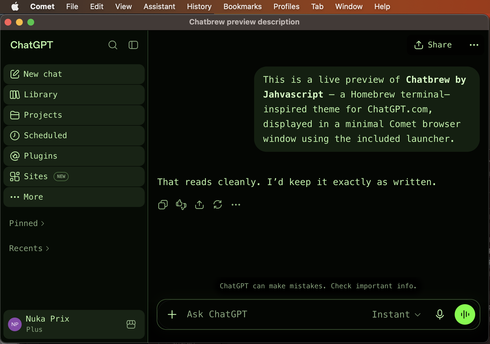

# Chatbrew

A Homebrew terminal–inspired theme for ChatGPT's website & a Comet browser launcher for a minimal, ChatGPT window without tabs, an address bar, or bookmarks where supported.

**By [Jahvascript](https://github.com/Jahvascript).**

A Homebrew terminal–inspired, black-and-neon-green skin for the real ChatGPT website. Inspired by a late-night coding setup: Menlo monospace, phosphor-green prompts, soft green responses, cyan links, and a subtle composer glow.

Use your regular ChatGPT account, conversations, and subscription. No API key or separate chat service.

## Live preview

## What’s included

- **Theme:** a CSS-only browser extension. Keeps ChatGPT’s standard navigation and controls.
- **Optional macOS launcher:** asks Comet to open ChatGPT in a minimalistic, terminal-inspired window, without tabs, bookmarks, or the address address bar.

## Install the theme

1. Download this repository using **Code → Download ZIP**, then unzip it. Alternatively, clone it.
2. Move the extracted folder somewhere permanent before installing. The browser loads the stylesheet from that folder.
3. In Comet, open **Extensions → Manage extensions**. In Chrome use `chrome://extensions`; in Edge use `edge://extensions`.
4. Turn on **Developer mode**.
5. Select **Load unpacked**, then choose the **extension** folder inside this repository.
6. Open [ChatGPT](https://chatgpt.com), sign in normally, and refresh any existing ChatGPT tabs.

If you installed an earlier copy of Chatbrew (previously Terminal Green), disable or remove that copy first so two versions do not compete.

Version 1.0.2 has been confirmed working in live Comet by its creator, including green sent-message bubbles and send/voice buttons. Chrome and Edge use the same extension format but have not been separately tested for this project.

## Update an existing installation

Replace the files in your installed extension folder with the latest files from `extension`, reload the extension on your browser’s Extensions page, and refresh ChatGPT.

## Optional: open a standalone Comet window

On macOS with Comet installed in `/Applications`:

1. Install the theme in Comet first.
2. In Finder, double-click **Open Minimal.command**.
3. The launcher requests a separate app-style window for ChatGPT. Resize it beside your editor.

Despite its name, the launcher does not switch to a different theme. It requests `--app=https://chatgpt.com` from the installed Comet browser and does not create a separate browser profile, quit existing windows, or change settings. Your browser determines which profile handles the launch; if your extension or login is in another profile, use that profile instead.

If double-clicking reports a file-permission problem, open Terminal, type `bash ` (including the space), drag **Open Minimal.command** into the Terminal window, and press Return.

The launcher’s mechanism is based on [Chromium’s app-by-URL window support](https://chromium.googlesource.com/chromium/src/+/main/chrome/browser/ui/startup/web_app_startup_utils.h). Comet may differ.

## Customize

Edit the color variables at the top of `extension/theme.css`. Then reload the extension on your browser’s Extensions page and refresh ChatGPT.

| Color | Default |
| --- | --- |
| Background | `#030603` |
| Terminal green | `#51ff16` |
| Reading text | `#b6f5a5` |
| Cyan accent | `#35d9e3` |

## Disable or uninstall

Open your browser’s Extensions page, switch Chatbrew off or select **Remove**, and refresh ChatGPT. Closing the optional app-style window does not uninstall the skin.

## Privacy and limitations

The extension contains a manifest and a local stylesheet only: no JavaScript, analytics, remote fonts, cookies, or conversation collection. It applies only to `https://chatgpt.com/*`. The launcher opens that URL using your installed Comet browser. The browser may display a site-access notice for the extension’s styling access.

This changes the website’s appearance, not the native ChatGPT or Codex apps. Feature availability still depends on ChatGPT, your account, and your browser. ChatGPT interface changes can require stylesheet updates; compatibility with every screen, voice mode, upload flow, or future update is not guaranteed.

This is an unofficial community theme, not affiliated with or endorsed by OpenAI or Perplexity. ChatGPT and Comet belong to their respective owners.

## License

[MIT](LICENSE).

---

## Everyone Is Welcome at JahvaScript

**Different backgrounds. Different experiences. One community.**

We welcome contributors of every background and experience
level. We value peace, respect, creativity, accessibility,
learning, and constructive collaboration.

- [Code of Conduct](https://github.com/Jahvascript/.github/blob/main/CODE_OF_CONDUCT.md)
- [Contributing](https://github.com/Jahvascript/.github/blob/main/CONTRIBUTING.md)
- [Accessibility](https://github.com/Jahvascript/.github/blob/main/ACCESSIBILITY.md)
- [Support](https://github.com/Jahvascript/.github/blob/main/SUPPORT.md)

Community contact: jahvascripts@gmail.com

*JahvaScript — Code with purpose. Build with unity.*
